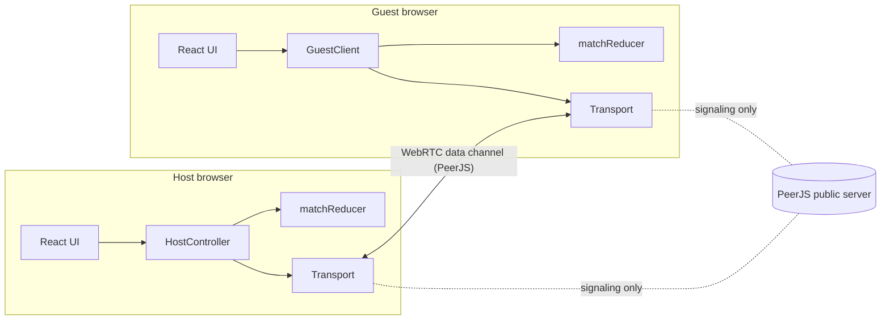

# Duel!

A 1v1 minigame showdown in the browser. One player hits **Quick duel** and shares a 4-letter room code (or link / QR code), a friend punches it in, and they play a best-of-3 or best-of-5 of quick games. No accounts, no install, no game server: the two browsers talk directly over WebRTC.

**Play:** https://esuhail.github.io/duel/

**Same keyboard mode:** two players on one device. A Reaction duel where both watch the same light; P1 hits `A`, P2 hits `L` (or each taps their half of a phone screen). It runs the same match reducer with no networking at all.

**Games:** ⚡ Reaction · 🧮 Quick Math · 🎯 Target Tap · 🔤 Unscramble · 🧠 Memory Sequence

## Run it

```bash
npm install
npm run dev            # http://localhost:5173
npm test               # unit + integration tests (Vitest)
npm run test:e2e       # two-browser match in Playwright
```

Open `http://localhost:5173/?net=local` in two tabs to play against yourself without touching the network (the tabs talk over `BroadcastChannel`).

## Architecture



| Layer | File(s) | Job |
| --- | --- | --- |
| Rules | `src/core/match.ts` | Pure reducer `(state, event) => state`. Phases: lobby → countdown → playing → roundResult → matchOver. No I/O, no timers, no randomness. |
| Randomness | `src/core/rng.ts` | mulberry32 seeded RNG, so a seed gives the same puzzle on both devices. |
| Clock sync | `src/core/clock.ts` | Ping/pong offset estimate (Cristian's algorithm) for a synced 3-2-1. |
| Host logic | `src/host/hostController.ts` | Owns the authoritative state, starts rounds, handles rejoin/forfeit timers. Depends only on the `Connection` interface. |
| Guest logic | `src/net/guestClient.ts` | Mirrors state, sends scores, reconnects, measures clock offset. |
| Protocol | `src/net/protocol.ts` | Typed messages + validation of everything the guest sends. |
| Transport | `src/net/*Transport.ts` | `peerjs` (real), `broadcast` (two tabs), `memory` (tests). |
| Games | `src/games/*` | One folder each: a pure `createPuzzle(seed)` and a React component. |

### Key decisions and why

**The host's browser is the server.** Zero hosting cost and no backend to maintain. The host runs the rules and the guest trusts it.

**Event sourcing instead of state syncing.** The host never sends "here is the new state". It sends the *event* (`roundStart`, `score`, ...) that it just applied, and the guest applies the same event to the same reducer. Messages stay tiny, and things like the round result are never sent at all: the guest computes it from the two `score` events, exactly as the host did. A full snapshot (`sync`) is only sent when someone joins or rejoins.

**Same puzzle for both players.** Each round the host picks a seed (derived from one match seed + round + attempt). Both clients build the puzzle from it, play locally, and report one number. Network lag can't affect your score because nothing happens over the network while you play.

**Synced start.** The guest pings the host 5 times, keeps the sample with the smallest round trip, and estimates `offset = hostTime − (t0 + t1) / 2`. The host sends `startAt` in its own clock; the guest converts it to local time. Error is at most half the best round trip (usually under 20 ms).

**Games are plugins.** Every game implements one interface (`src/games/types.ts`). Puzzle generation is a separate pure function so determinism is unit-tested per game.

**Disconnects.** A heartbeat in the PeerJS transport detects a vanished peer within ~8 s (WebRTC alone can take much longer). The guest retries the same room every 2 s; the host waits 30 s before the guest forfeits. A guest who rejoins mid-round gets a fresh replay of that round, because their half-played game is gone. A refresh rejoins too: the guest's identity token lives in `sessionStorage`.

## Trade-offs (read before relying on this)

- **The host can cheat.** It runs the rules and could fake results with dev tools. The guest could also send a fake score. Fine between friends; a ranked mode would need the host logic on a server (the `HostController` only depends on `Connection`, so it can move to Node with a WebSocket transport).
- **Some networks block peer-to-peer.** Strict school/corporate Wi-Fi and some carrier NATs can't connect directly. PeerJS's defaults include a public TURN relay as fallback; for reliability, set your own TURN server via `VITE_TURN_URL`, `VITE_TURN_USER`, `VITE_TURN_PASS`.
- **Depends on the free PeerJS signaling server** for the initial handshake. If it's down, nobody can create or join matches (games in progress continue).
- **If the host refreshes, the match is lost.** Host state lives only in memory.
- **4-letter room codes are guessable.** 24⁴ ≈ 330k codes keeps clashes rare (a clash just picks another code), but a stranger could land in an open lobby. A longer code or a join confirmation would fix it.
- **Same-keyboard mode only has Reaction.** It's the only game two people can share one keyboard or screen for fairly; the others need a full keypad or screen each.
- **Seeded puzzles are predictable** to anyone who reads the seed off the wire. Again: between friends, fine.
- **Memory Sequence ties are common** (both reach length 7). Ties replay with a new seed, which works but can drag.

## Testing

- **Unit** (`*.test.ts`): RNG determinism, every game's puzzle is reproducible from its seed, reducer edge cases (ties, best-of-5 math, late/duplicate/garbage scores, forfeits, rematch, game order with no repeats).
- **Integration** (`src/host/session.test.ts`): real `HostController` + `GuestClient` over the in-memory transport with fake timers: full match, clock sync, third player rejected, drop + rejoin, 30 s forfeit.
- **End to end** (`tests/e2e`): Playwright opens two pages, creates and joins a match over `?net=local`, and bots play every game to the end, then rematch.
- **Manual**: a real match between a phone on cellular data and a laptop on home Wi-Fi (PeerJS path).

## Deploy

Pushing to `main` builds and deploys to GitHub Pages (`.github/workflows/deploy.yml`). One-time setup: repo **Settings → Pages → Source: GitHub Actions**.

Optional usage counting: create a free [GoatCounter](https://www.goatcounter.com) site and add its code as a repository variable `GOATCOUNTER_CODE`. The host reports one `match-complete` event per finished match; no cookies, no personal data.

## License

MIT
